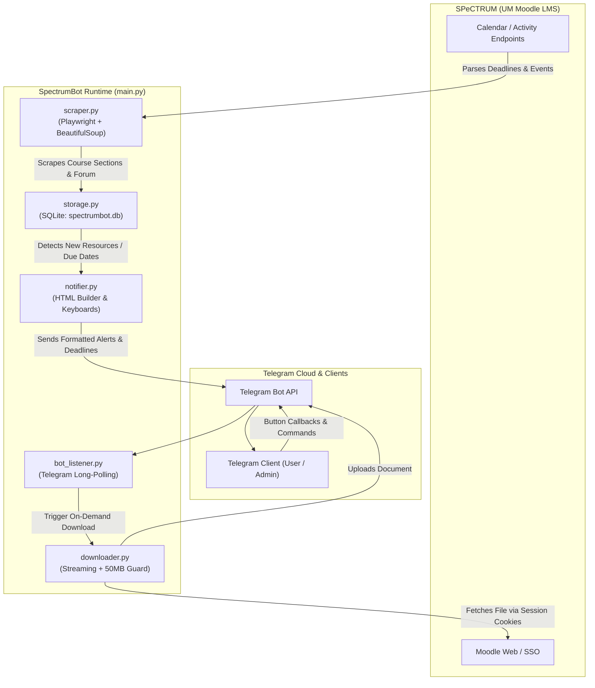

# 🛠️ SpectrumBot - Technical Documentation & Developer Guide

This document covers the technology stack, architectural design, component interactions, database schema, session handling, background process management, and developer setup for SpectrumBot.

---

## 🏗️ 1. Architecture Overview



### Component Breakdown:
- **`main.py`**: CLI entrypoint and orchestrator. Dispatches commands (`--login`, `--check`, `--watch`, `--deadlines`, `--get-chat-id`, `--test-tg`) and initiates the periodic monitoring loop alongside the Telegram listener.
- **`scraper.py`**: Automated browser interaction via Playwright Chromium. Navigates course pages using saved session cookies, extracts course structures, weekly sections, file resources, forum announcements, and assignment due dates.
- **`storage.py`**: SQLite data persistence engine (`spectrumbot.db`). Handles schema creation, data deduplication, diff detection for new materials, assignment tracking, and subscriber access control.
- **`downloader.py`**: Authenticated streaming downloader. Inspects HTTP response headers (`Content-Length`) and enforces Telegram's 50MB bot upload limit; files exceeding 50MB fallback to direct SPeCTRUM links.
- **`notifier.py`**: Telegram message formatting engine. Generates HTML formatted notifications, inline action keyboards (`[📥 Send File Here]`, `[📂 Browse]`), and multi-category assignment dashboards.
- **`bot_listener.py`**: Telegram long-polling event loop. Handles interactive commands (`/start`, `/deadlines`, `/courses`, `/search`, `/status`, `/login`), callback queries for course browsing and file delivery, and admin subscriber approval.
- **`login.py`**: Browser-based interactive authentication wizard for Microsoft 2FA SSO. Saves browser session state to `auth_state.json`.
- **`config.py`**: Centralized configuration loader. Reads environment variables from `.env` and provides fallback path resolution.

---

## 💻 2. Technology Stack

| Layer / Domain | Technology / Library | Purpose & Technical Rationale |
| :--- | :--- | :--- |
| **Language & Runtime** | **Python 3.10+** | Utilizes modern standard library features including static type hints (`typing`), multi-threading (`threading`), embedded SQLite (`sqlite3`), filesystem abstraction (`pathlib`), regular expressions (`re`), and CLI parsing (`argparse`). |
| **Browser Automation** | **Playwright for Python** (`playwright>=1.40.0`) | Automates browser context creation, DOM navigation, and Microsoft SSO OAuth2 login redirects. Chosen over Selenium for faster execution, headless resilience, and native cookie storage state serialization (`context.storage_state()`). |
| **Browser Engine** | **Chromium** (Playwright Managed) | Isolated, headless Chromium binary executing dynamic client-side JavaScript on Moodle and rendering interactive login pages. |
| **HTML / DOM Parsing** | **BeautifulSoup4** (`beautifulsoup4>=4.12.0`) | Parses raw HTML into DOM trees to extract course weekly outlines, resource links, activity icons, forum threads, and calendar dates with high speed and fault tolerance. |
| **HTTP Networking** | **Requests** (`requests>=2.31.0`) | Lightweight HTTP client for long-polling the Telegram Bot API (`getUpdates`), dispatching webhookless alerts, and performing chunked authenticated file downloads with header inspection. |
| **Embedded Database** | **SQLite 3** (`spectrumbot.db`) | Zero-configuration, serverless embedded relational database with Write-Ahead Logging (`WAL` mode) for safe concurrent reads/writes between the scraping daemon and Telegram listener thread. |
| **Bot Interface** | **Telegram Bot API** | Direct end-user client layer leveraging custom inline keyboards (`InlineKeyboardMarkup`), persistent menus (`ReplyKeyboardMarkup`), document streaming (`sendDocument`), and HTML formatting. |
| **Configuration** | **python-dotenv** (`python-dotenv>=1.0.0`) | 12-Factor App configuration pattern, isolating sensitive bot tokens, chat IDs, and course filters in `.env` without hardcoding credentials in source code. |
| **macOS Daemon** | **Launchd (LaunchAgent)** | Native macOS background service architecture (`com.um.spectrumbot.plist`) with `RunAtLoad` and `KeepAlive` for auto-restarting on user login and surviving terminal/VS Code closures. |
| **Windows Daemon** | **Pythonw.exe & PowerShell** | Windowless process backgrounding via `pythonw.exe`, Windows Startup folder (`shell:startup`) integration for boot auto-start, and PowerShell process termination. |
| **Shell Scripting** | **Bash (`.sh`) & Batch (`.bat`)** | Cross-platform 1-click bootstrap scripts for virtual environment creation, pip dependency installation, browser binary download, and service management. |

---

## 📂 3. Full Project Structure

```
SpectrumBot/
├── main.py                      # CLI entrypoint (--login, --check, --watch, --deadlines, --get-chat-id)
├── scraper.py                   # Playwright + BeautifulSoup SPeCTRUM scraper & deadline parser
├── bot_listener.py              # Telegram long-polling listener (commands & button callbacks)
├── notifier.py                  # Telegram HTML formatting, keyboards & document delivery
├── downloader.py                # Authenticated streaming downloader with 50MB guard
├── storage.py                   # SQLite database (diffing, search, subscribers, deadlines)
├── config.py                    # Environment configuration & path resolver
├── login.py                     # Interactive 2FA login wizard
├── setup.bat                    # Windows: 1-Click setup wizard (venv + Playwright Chromium)
├── setup.sh                     # macOS/Linux: 1-Click setup wizard (venv + Playwright Chromium)
├── enable_autostart_windows.bat # Windows: Enable boot auto-start (silent background)
├── disable_autostart_windows.bat# Windows: Disable boot auto-start
├── start_background.bat         # Windows: Silent background runner (pythonw.exe)
├── stop_background.bat          # Windows: Background stopper
├── run_watch.bat                # Windows: Foreground console runner (debugging)
├── start_background.sh          # macOS: launchd background service installer (boot auto-start)
├── stop_background.sh           # macOS: Service uninstaller
├── run_watch.sh                 # macOS: Foreground console runner (debugging)
├── requirements.txt             # Python dependencies (Playwright, requests, python-dotenv, etc.)
├── .env.example                 # Template for environment variables (Bot Token, Chat ID)
├── .env                         # Local configuration credentials (ignored by git)
├── auth_state.json              # SPeCTRUM session cookies & SSO tokens (generated by --login)
├── spectrumbot.db               # Local SQLite database storing materials, announcements, deadlines
└── spectrumbot.log              # Background service log output
```

---

## 🔐 4. Authentication & Session Flow

1. **Passwordless QR Login via Telegram (`remote_telegram_login`)**:
   - The user triggers `/login` (or `/login <email>`) on Telegram.
   - The bot launches a headless Chromium instance, enters the user's `SISWA_EMAIL`, and captures Microsoft SSO's passwordless **Authenticator QR Code / Number prompt**.
   - The screenshot is sent directly to the user's Telegram chat.
   - The user opens **Microsoft Authenticator** on their phone and scans the QR code / approves the prompt.
   - The headless browser detects the completed redirect, saves session cookies to `auth_state.json`, and confirms success in Telegram—no password is ever entered or stored.
2. **Interactive Desktop Wizard (`interactive_login`)**:
   - CLI command: `python main.py --login`.
   - Launches a visible Chromium browser via Playwright directly to Microsoft SSO.
   - The user completes authentication in the open browser, and upon URL redirect to the dashboard, Playwright captures storage state via `context.storage_state(path=AUTH_STATE_FILE)`.
3. **Silent Session Renewal (`verify_or_renew_session`)**:
   - When SPeCTRUM Moodle cookies expire while underlying Microsoft SSO tokens remain valid, the bot performs a headless silent refresh in the background, updating `auth_state.json` without user interaction.

---

## 🗄️ 5. SQLite Database Schema

SpectrumBot uses SQLite (`spectrumbot.db`) with WAL mode for concurrent read/write operations.

### Table: `resources`
Stores discovered course activities, lecture slides, and materials.
```sql
CREATE TABLE IF NOT EXISTS resources (
    id INTEGER PRIMARY KEY AUTOINCREMENT,
    course_id TEXT,
    course_name TEXT,
    section_name TEXT,
    resource_id TEXT UNIQUE,
    title TEXT,
    url TEXT,
    type TEXT,
    first_seen TIMESTAMP,
    last_updated TIMESTAMP
);
```

### Table: `announcements`
Stores forum posts and course announcements to prevent duplicate alerts.
```sql
CREATE TABLE IF NOT EXISTS announcements (
    id INTEGER PRIMARY KEY AUTOINCREMENT,
    course_id TEXT,
    course_name TEXT,
    discussion_id TEXT UNIQUE,
    title TEXT,
    author TEXT,
    posted_time TEXT,
    content_snippet TEXT,
    first_seen TIMESTAMP
);
```

### Table: `deadlines`
Tracks assignments, quizzes, and submission cutoffs across all enrolled courses.
```sql
CREATE TABLE IF NOT EXISTS deadlines (
    id INTEGER PRIMARY KEY AUTOINCREMENT,
    event_id TEXT UNIQUE,
    course_id TEXT,
    course_name TEXT,
    title TEXT,
    url TEXT,
    due_date TIMESTAMP,
    due_date_str TEXT,
    status TEXT,
    warned_48h INTEGER DEFAULT 0,
    warned_24h INTEGER DEFAULT 0,
    first_seen TIMESTAMP,
    last_updated TIMESTAMP
);
```

### Table: `subscribers`
Maintains subscribed Telegram chat IDs and administrator authorization states.
```sql
CREATE TABLE IF NOT EXISTS subscribers (
    id INTEGER PRIMARY KEY AUTOINCREMENT,
    chat_id TEXT UNIQUE,
    first_name TEXT,
    username TEXT,
    joined_at TIMESTAMP,
    is_approved INTEGER DEFAULT 0
);
```

---

## ⚙️ 6. Background Process Management

### 🪟 Windows Background Runner (`start_background.bat`)
- Invokes `pythonw.exe main.py --watch`.
- `pythonw.exe` runs Python without attaching a console window, allowing it to execute invisibly in the background.
- Standard output and errors are redirected to `spectrumbot.log`.
- To stop the process, `stop_background.bat` uses PowerShell to locate and terminate any process running `main.py --watch`:
  ```powershell
  Get-CimInstance Win32_Process | Where-Object { $_.CommandLine -like '*main.py*--watch*' } | Stop-Process -Force
  ```

### 🪟 Windows Auto-Start (`enable_autostart_windows.bat`)
- Creates a Windows shortcut in the user's Startup folder:
  `%APPDATA%\Microsoft\Windows\Start Menu\Programs\Startup\SpectrumBot.lnk`
- The shortcut points to `start_background.bat` with `WindowStyle = 7` (Minimized).

### 🍎 macOS System Service (`start_background.sh`)
- Generates a user LaunchAgent property list at `~/Library/LaunchAgents/com.um.spectrumbot.plist`:
  - `Label`: `com.um.spectrumbot`
  - `ProgramArguments`: `[path_to_venv_python, main.py, --watch]`
  - `RunAtLoad`: `true`
  - `KeepAlive`: `true`
  - `StandardOutPath` / `StandardErrorPath`: `spectrumbot.log`
- Loaded via `launchctl load ~/Library/LaunchAgents/com.um.spectrumbot.plist`.
- **Lifecycle behavior**: The service runs as a user LaunchAgent, active whenever the user is logged into their macOS session. If the Mac sleeps or shuts down, monitoring pauses and resumes automatically upon wake/login.

---

## 🔧 7. Advanced Configuration Options

In your `.env` file:

```env
# Mandatory Telegram Credentials
TELEGRAM_BOT_TOKEN=123456789:ABCdefGHIjklMNOpqrSTUvwxYZ
TELEGRAM_CHAT_ID=123456789

# Scraping Frequency (default: 30 minutes)
CHECK_INTERVAL_MINUTES=30

# SPeCTRUM Base URL
SPECTRUM_BASE_URL=https://spectrum.um.edu.my

# Optional Course Whitelist (comma-separated course IDs or name fragments)
# Example: MONITORED_COURSES=WIA2001,WIA2006
# Leave empty to monitor ALL courses found on your SPeCTRUM dashboard
MONITORED_COURSES=

# Course Blacklist (comma-separated keywords to ignore)
EXCLUDED_COURSES=LEAP,Turnitin
```

---

## 🧪 8. Developer CLI Reference

You can run individual subsystems directly from your virtual environment:

| Command | Purpose |
| :--- | :--- |
| `python main.py --login` | Launch browser for SSO / 2FA authentication |
| `python main.py --check` | Run a single immediate scrape and print console diffs |
| `python main.py --deadlines` | Parse and print current assignment and quiz deadlines |
| `python main.py --get-chat-id` | Poll Telegram for incoming `/start` messages and print detected Chat ID |
| `python main.py --test-tg` | Send a test welcome card and keyboard menu to configured Telegram chat |
| `python main.py --watch` | Start the persistent scheduler loop and Telegram polling daemon |
